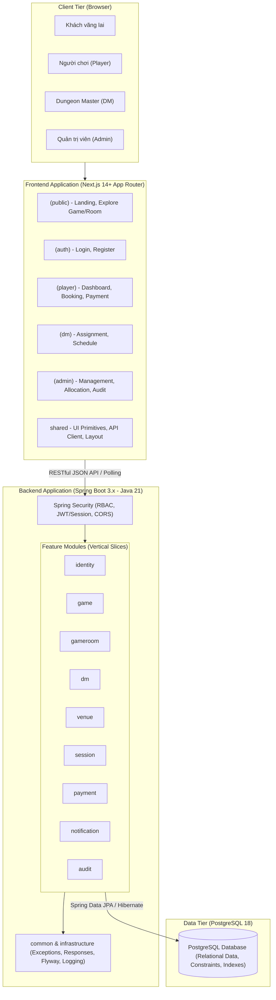

# Kiến Trúc Hệ Thống (System Architecture)

**Dự án:** Kịch Bản Sát — Web-based Booking Platform  
**Phiên bản:** V15 Final Baseline  
**Trạng thái:** Accepted Design

---

## 1. Tổng quan Hệ thống (System Overview)

Kịch Bản Sát là nền tảng web phục vụ người chơi board game kịch bản (Murder Mystery Game / Larp / RPG), hỗ trợ người chơi khám phá game, tự tạo phòng đề xuất thời gian linh hoạt (mốc `HH:00` hoặc `HH:30`), tập hợp nhóm đủ điều kiện, sau đó phối hợp với Admin quán và Dungeon Master (DM) để bố trí phòng vật lý và tổ chức phiên chơi trực tiếp tại địa điểm quán.

### 1.1. Các Vai Trò Người Dùng (Actors)
1. **Khách vãng lai (Guest):** Truy cập Home Page công khai, tra cứu danh mục kịch bản, xem chi tiết game và các phòng chơi đang mở công khai.
2. **Người chơi (Player):** Đăng ký/đăng nhập, tạo phòng chơi mới (tối đa 3 phòng hoạt động), tham gia/rời phòng, biểu quyết đổi lịch, đặt cọc 30% và thanh toán 70% còn lại.
3. **Dungeon Master (DM):** Nhận phân công từ Admin, chấp nhận hoặc từ chối dẫn phiên chơi, cập nhật lịch rảnh và xác nhận bắt đầu phiên chơi.
4. **Quản trị viên (Admin):** Quản lý kịch bản và phòng vật lý, duyệt phòng đủ điều kiện, phân công DM, sắp xếp phòng vật lý, duyệt hủy/reopen phòng, duyệt hoàn tiền mô phỏng (0% hoặc 100%).

---

## 2. Kiến trúc Tổng thể (High-level Architecture)

Hệ thống được thiết kế theo mô hình **Monolithic Modular** hiện đại (không dùng Microservices trong phạm vi MVP), phân tách rõ ràng giữa Frontend và Backend:

---

## 3. Các Phân Hệ Chức Năng (Feature Modules Breakdown)

Cả Backend và Frontend đều tổ chức mã nguồn theo nguyên lý **Feature-oriented Architecture** thống nhất:

| Feature Module | Trách nhiệm chính trong hệ thống |
| :--- | :--- |
| **`identity`** | Xác thực người dùng, phân quyền RBAC (Player, DM, Admin), quản lý tài khoản và phiên. |
| **`game`** | Quản lý danh mục kịch bản, số lượng người chơi (min/max), thời lượng dự kiến, điều kiện thành lập. |
| **`gameroom`** | Quản lý vòng đời phòng tuyển người (Lobby), cơ chế slot, cửa sổ thay thế (replacement), reopen recruitment. |
| **`dm`** | Quản lý hồ sơ DM, tiếp nhận yêu cầu phân công, chấp nhận/từ chối dẫn game, quản lý lịch khả dụng. |
| **`venue`** | Quản lý danh sách phòng vật lý tại quán (`PhysicalRoom`), sức chứa tối đa, trạng thái sẵn sàng. |
| **`session`** | Lên lịch phiên chơi chính thức, xác nhận chuẩn bị tối thiểu 12 giờ, khởi động và kết thúc phiên chơi. |
| **`payment`** | Quản lý quy trình mô phỏng cọc 30% (làm tròn lên 1.000đ), thanh toán 70% còn lại, chính sách hoàn tiền 0%/100%. |
| **`notification`** | Notification Center lưu trữ DB, phân phát thông báo qua cơ chế Polling định kỳ cho người dùng. |
| **`audit`** | Ghi nhận nhật ký kiểm toán hành vi quản trị, lý do hủy phòng, lý do đổi lịch, lý do hoàn tiền. |

---

## 4. Nguyên Tắc Bảo Mật & Ranh Giới Ủy Quyền (Security & Authorization Boundaries)

1. **Backend là Single Source of Truth:**
   - Mọi quy tắc nghiệp vụ, kiểm tra trạng thái, chuyển đổi State Machine và kiểm tra quyền truy cập tài nguyên (Resource Authorization) phải được thực thi độc quyền tại Backend.
   - Frontend Route Guards và điều kiện ẩn hiện UI chỉ phục vụ trải nghiệm người dùng (UX), tuyệt đối không được coi là cơ chế bảo mật.
2. **CORS Least Privilege:**
   - Chỉ cho phép các domain được định danh trước (mặc định `http://localhost:3000` trên môi trường local) gửi request qua API.
3. **Bảo vệ Thông tin Nhạy cảm:**
   - Tuyệt đối không trả về stack trace ngoại lệ, thông tin cơ sở hạ tầng hoặc secret trong API response.
   - Sử dụng chuẩn mã lỗi và thông điệp an toàn thông qua `GlobalExceptionHandler`.
4. **Không chạy quyền Superuser:**
   - Kết nối runtime của ứng dụng Backend tới PostgreSQL phải thông qua user ứng dụng có quyền giới hạn trên schema dự án, không dùng tài khoản `postgres` superuser.
